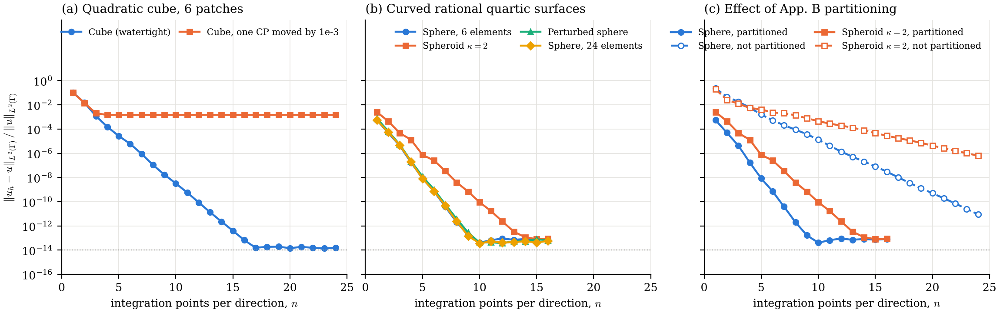
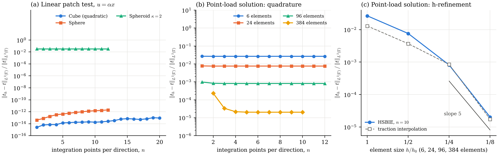

# igabem-elasticity

A 3D collocation isogeometric boundary element method (IgBEM) for linear elastostatics, following
Taus, Rodin, Hughes & Scott, *Isogeometric boundary element methods and patch tests for linear elastic
problems*, CMAME 357 (2019) 112591. This is the core that the planned extensions build on, starting
with a thickness-robust solver for thin curved plates.

**Status.**

- **Milestone 1 (SBIE, Neumann):** the interior Neumann patch test passes to machine precision on the
  watertight quadratic cube and on exact rational spheres, spheroids and a perturbed sphere. The
  imperfect cube stalls at a constant error, as it does in the paper.
- **Milestone 2 (HSBIE, Dirichlet):** the traction equation is regularized by Taylor subtraction and
  solved for a discontinuous traction space. The linear Dirichlet patch test is exact; a Kelvin
  point-load solution checks quadrature and h-convergence. See [Results](#results).

## Build and run

Requires a C++17 compiler, CMake ≥ 3.16, Eigen ≥ 3.3, optionally OpenMP; Python 3 with NumPy and
Matplotlib for geometry generation and plots.

```sh
python3 python/make_geometries.py 3      # writes geo/*.dat (cube, imperfect cube, sphere family r0..r3)
cmake -S . -B build && cmake --build build -j
./build/patch_test geo/cube_p2.dat cube --nmin 1 --nmax 24
./build/dirichlet_test geo/sphere_r0.dat sphere --nmin 1 --nmax 10 [--source 1.5 1.7 2.0]
ctest --test-dir build                   # finite-difference check of all Kelvin kernels
./results/run_all.sh                     # Neumann runs -> results/patch_tests.csv (~10 min on 4 cores)
./results/run_dirichlet.sh               # Dirichlet runs -> results/dirichlet_tests.csv (~20 min)
python3 python/plot_patch_tests.py       # -> results/fig_patch_tests.{pdf,png}
python3 python/plot_dirichlet_tests.py   # -> results/fig_dirichlet_tests.{pdf,png}
```

## Plan check

**Theory.** Displacement boundary integral equation (SBIE) for an interior domain with outward normal,
Kelvin fundamental solution in the Brebbia–Dominguez convention (`src/kelvin.hpp`). The free term is
never formed: rigid translations give σ(x) = −PV∫T dΓ, so the equation is used in the regularized form

```
∫_Γ T(x,y) [u(y) − u(x)] dΓ_y = ∫_Γ U(x,y) t(y) dΓ_y
```

Both integrands are O(1/r), so the same scheme handles smooth points, C⁰ patch edges and cube corners.
This is the paper's σ = −K·1 identity (App. C).

The traction equation (HSBIE) follows from applying the traction operator at x to the interior
representation, t_i(x) = ∫ D_im t_m − ∫ S_im u_m with D = T_x U (O(1/r²)) and S = T_x (T_y U)ᵀ (O(1/r³))
(`KelvinTraction` in `src/kelvin.hpp`; verified against finite differences by `tests/test_kernels.cpp`).
It is regularized by subtracting the linear field u_L(y) = u(x) + ∇u(x)(y − x), whose traction σ(x)n
satisfies the representation exactly. That removes the free term and leaves two O(1/r) integrands:

```
∫_Γ D(x,y) [t(y) − σ(x) n(y)] dΓ_y = ∫_Γ S(x,y) [u(y) − u(x) − ∇u(x)(y − x)] dΓ_y
```

∇u(x) combines the tangential derivatives of the Dirichlet data with the normal derivative implied by
t(x) through Hooke's law, so the unknown t(x) appears on both sides (`HsbieAssembler::gradient`). The
data part of the right-hand side is subtracted point by point, which keeps round-off at 1e-14 instead
of growing like n⁴. The subtraction needs u ∈ C¹ and t continuous at x, so traction collocation points
are kept strictly inside patches.

**Physics.** λ = μ = 1 (ν = 1/4). Exact field u = αx, α = diag(−¼, −¼, 1), so σ = diag(0, 0, 5/2) and
t = σn. Pure Neumann data leaves the six rigid-body modes undetermined; they are removed (see Numerics).
For the Dirichlet runs a second exact field is the Kelvin solution of a unit point load at
(1.5, 1.7, 2.0), outside the unit sphere, in direction (1, 2, 3)/√14. It is smooth in the body but not
polynomial, so it tests quadrature and approximation together.

**Numerics.**

| Item | Choice | Where |
| --- | --- | --- |
| Geometry | Multipatch NURBS in Bembel `.dat` format, any degree, rational weights | `src/nurbs.hpp` |
| Displacement space | Isoparametric: the geometry's own rational basis. Control points that coincide across patches are merged into one conforming dof, so a gap (imperfect cube) leaves dofs unmerged | `Mesh::build` |
| Collocation | Greville abscissae of each dof's first owning patch | `Mesh::build` |
| Singular quadrature | Duffy split of the integration cell into up to 4 triangles at the collocation point, n×n Gauss–Legendre per triangle | `duffyRect` |
| Curvature / aspect partitioning | App. B: split cells until the normal-angle change across a cell is ≤ 1/8 rad (κh ≤ 1/8) and the aspect ratio is ≤ 3 | `partitionElement` |
| Near-singular quadrature | App. B: quadtree refinement towards the closest point while d ≤ 3h | `nearRect` |
| Solver | Dense bordered system [A R; Rᵀ 0] with the 6 rigid modes R, partial-pivot LU | `app/patch_test.cpp` |
| Error measure | Relative L²(Γ) displacement error after removing the L²-best rigid motion, 10×10 Gauss per cell | `relativeL2Error` |
| Rank / conditioning | Full SVD of A every run: σ₆/σ_max (should vanish with the quadrature error, rank deficiency 6) and σ₇/σ_max (smallest non-rigid singular value) | `patch_test` output |
| Kernel check | ‖A·R_rot‖/‖A‖: rotations carry zero traction, so this must vanish. It catches sign or index errors in T | `patch_test` output |
| Traction space (HSBIE) | The geometry's rational basis on each patch, discontinuous across patches (no merging), as the paper prescribes at edges and corners | `TractionSpace` |
| Traction collocation | Greville points with the first and last moved halfway inwards, so every point is interior to its patch | `TractionSpace::shifted` |
| Dirichlet data | Exact coefficients for u = αx; Greville interpolation for the point-load field | `interpolateDisplacement` |
| Solver (HSBIE) | Dense partial-pivot LU; 2-norm condition number from a full SVD every run | `app/dirichlet_test.cpp` |
| Shared quadrature | One driver for both equations: Duffy at the source point, App. B near-singular quadtree, Gauss elsewhere | `src/integrator.hpp` |

**Visualization.** Semilog plots of error against integration points per direction, matching the
paper's Figs. 2, 3, 6 and 7, plus a CSV of every run (`results/patch_tests.csv`).

## Assumptions and deviations (please read)

1. **The base quadrature of Taus, Rodin & Hughes (MMMAS 2016) was not available and is reconstructed.**
   This code uses Duffy/polar splitting at the collocation point on the regularized integrands. That is a
   standard scheme with the same property the paper relies on (exponential convergence in n), but it is
   not guaranteed to be their rule.
2. **The HSBIE regularization is also a reconstruction.** It is the classical constant-strain (Taylor)
   subtraction, not necessarily the "same technique as Laplace" the 2019 paper cites. One consequence:
   for u = αx the regularized residual of the exact solution vanishes point by point, so the linear
   Dirichlet patch test is passed for every n and does not test the quadrature. The paper's Fig. 5 shows
   exponential convergence in n, so its regularization must differ. The point-load test fills that gap.
3. **Cross-check with Keshava & Schanz (2025, [arXiv 2505.00713](https://arxiv.org/abs/2505.00713)).**
   Followed: the Kelvin tensor (their eq. 5, identical to ours after substituting ν), the form of the
   HBIE (their eq. 7: K′ = T_x U and D = −T_x(T_y U)ᵀ, our D and S up to that sign convention), and Duffy
   + Gauss for weakly singular collocation integrals. Not followed: their regularization of the
   hypersingular operator (eq. 23, after Han and Nédélec). It moves surface-curl derivatives onto the
   Galerkin test function v(x), which does not exist at a collocation point; their own collocation
   examples use only the SBIE. Their line integrals vanish on our closed surfaces, and they matter again
   only for open surfaces or a split into Dirichlet and Neumann parts.
4. The κh ≤ 1/8 criterion is estimated from the normal-angle span of a cell (centre-to-corner angle × 2),
   not from principal curvatures.
5. Traction data are evaluated exactly at quadrature points (t = σn with the discrete geometry's normal)
   instead of being projected onto a traction basis. For this test that removes data error rather than
   adding it.
6. Rigid-body removal: the paper says only that rigid motion is "nullified"; here it is a bordered system
   plus an L²-best rigid fit in the error.
7. The sphere is Bembel's exact six-patch rational quartic (`geo/bembel_sphere.dat`, from
   [temf/bembel](https://github.com/temf/bembel), GPL-3.0). The spheroid is its exact affine image. The
   perturbed sphere is a smooth radial perturbation of the control points, not the paper's
   parametrization. Bembel itself is not linked yet; its H² compression is the planned route to the fast
   solver.

## Results

### Interior Neumann (SBIE)

| Geometry | Dofs (unknowns) | Integration cells | n for error < 1e-12 | Best error (n) | Error at n = 10, no partitioning |
| --- | --- | --- | --- | --- | --- |
| Cube, 6 quadratic patches (watertight) | 26 (78) | 6 | 15 | 1.4e-14 (23) | 3.2e-9 (flat faces: same as partitioned) |
| Cube, one control point moved by 1e-3 | 27 (81) | 6 | never: stalls at 1.5e-3 | 1.5e-3 | 1.5e-3 |
| Exact sphere, 6 rational quartic elements | 98 (294) | 6,144 | 9 | 4.1e-14 (10) | 1.3e-5 |
| Exact spheroid κ = 2 | 98 (294) | 3,816 | 13 | 8.1e-14 (15) | 4.5e-4 |
| Perturbed sphere | 98 (294) | 5,052 | 9 | 3.7e-14 (12) | not run |
| Exact sphere, refined once (24 elements) | 152 (456) | 6,144 | 9 | 3.6e-14 (10) | not run |

Diagnostics on every watertight case: the rotation residual ‖A·R_rot‖/‖A‖ reaches 1e-14, the six rigid-mode
singular values fall to the quadrature error, and σ₇/σ_max stays fixed (0.082 cube, 0.0048 sphere), so
A has numerical rank 3M − 6 and the bordered system is well conditioned. On the imperfect cube the rotation
residual stays at 4.7e-5: the gap breaks the rigid-body identity, which is exactly what this patch test is
meant to expose. The paper reports a stall near 1e-4 for its imperfect cube (Fig. 3); our 1.5e-3 uses a
different normalization (relative L²(Γ) after rigid-motion removal) and is not directly comparable.

Without partitioning the error still decays exponentially but much more slowly (sphere 9e-12 and spheroid
6e-7 at n = 24), reproducing the qualitative message of the paper's Figs. 6–7.



### Interior Dirichlet (HSBIE)

| Case | Traction unknowns | Result | Reference |
| --- | --- | --- | --- |
| Linear patch test, quadratic cube | 162 | 2.5e-15 – 9e-14 for every n | exact |
| Linear patch test, exact sphere | 450 | 4e-14 (n = 1) to 1.5e-12 (n = 10) | exact |
| Linear patch test, spheroid κ = 2 | 450 | stalls at 3.2e-2 for every n | t = σn is not in the traction space (n is not rational on a spheroid) |
| Point load, sphere, 6 elements | 450 | 2.7e-2 | interpolation 1.3e-2 |
| Point load, sphere, 24 elements | 648 | 7.6e-3 | interpolation 3.7e-3 |
| Point load, sphere, 96 elements | 1,152 | 8.1e-4 | interpolation 8.5e-4 |
| Point load, sphere, 384 elements | 2,592 | 2.0e-5 (n ≥ 5) | interpolation 1.7e-5 |

All results are relative L²(Γ) traction errors.

- **Linear patch test.** Exact to round-off on the cube and the sphere, but for every n, including n = 1.
  With Taylor subtraction the residual of the exact solution vanishes point by point (see assumption 2),
  so this test checks consistency of the formulation, not the quadrature. On the curved sphere round-off
  grows slowly with n (1.5e-12 at n = 10), from cancellation inside the t(x)-dependent matrix terms. The
  spheroid stalls, as in the paper's Fig. 5, because its normal is not exactly representable.
- **Point-load solution.** The quadrature converges by n ≈ 4–6 at every refinement level. The error then
  stays within a factor of about 2 of the traction interpolation error at every level, so the method is
  quasi-optimal. Between 96 and 384 elements the error drops by a factor of 40, a rate of 5.3, matching
  p + 1 = 5 for the quartic sphere. The coarser levels are still pre-asymptotic: the source sits 1.9 radii
  from the centre.
- **Conditioning.** 2-norm condition numbers are 146 (cube) and 1,241 → 139 (sphere, 6 → 384 elements).
  They decrease under refinement, consistent with the paper's claim that the regularized system stays well
  conditioned.



## Next steps

1. Exterior Neumann (Eshelby) patch test; mixed Dirichlet–Neumann problems.
2. Thin curved plate (cylindrical panel built as exact NURBS): Neumann patch test for t/R = 10⁻¹…10⁻³,
   then Scordelis–Lo as a 3D solid.
3. Iterative solver, preconditioner and H² compression.

## License

GPL-3.0 (see `LICENSE`), matching Bembel, whose sphere geometry is included and whose library is the
intended base.
