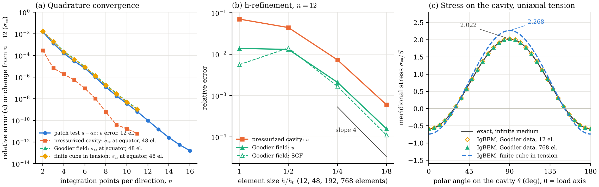
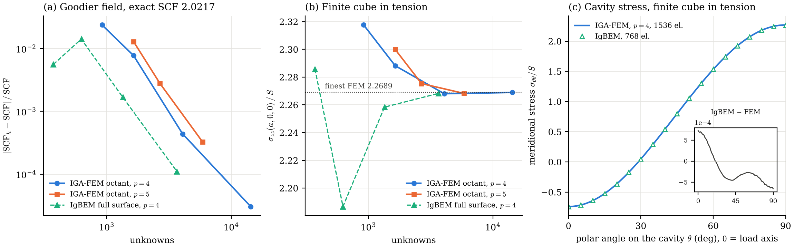
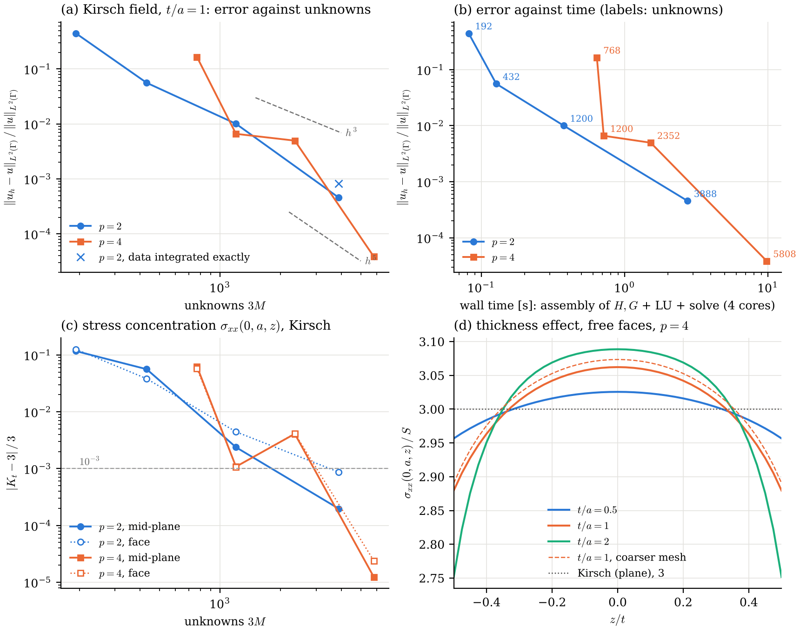
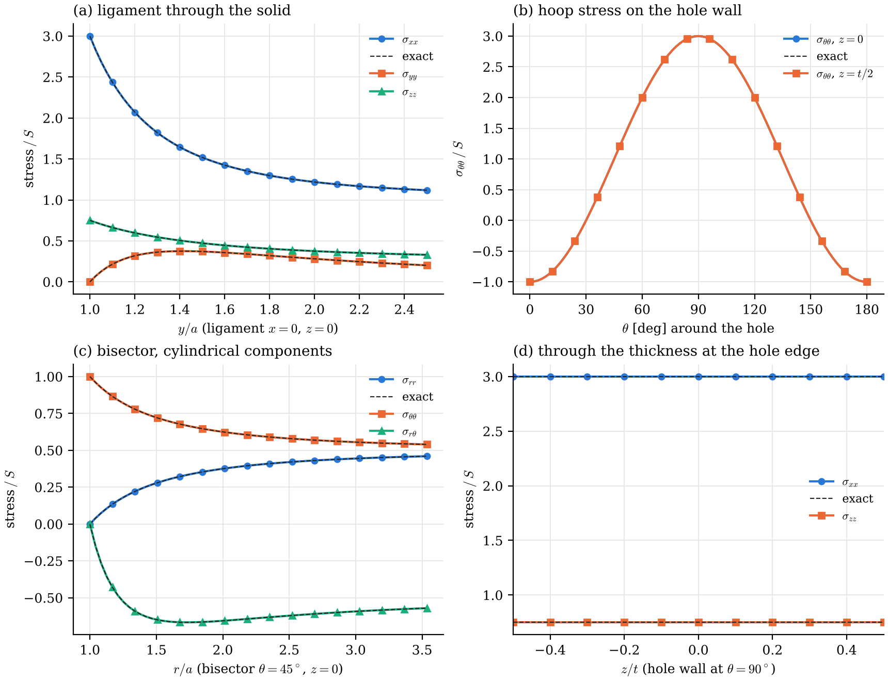
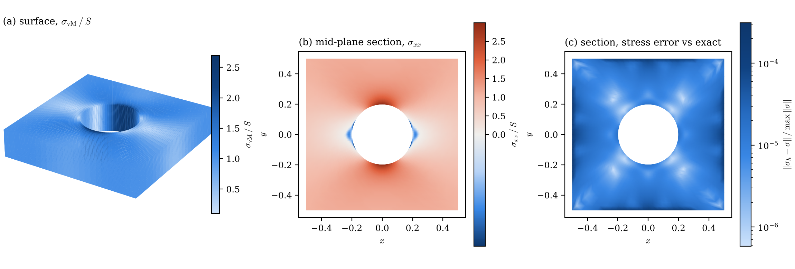
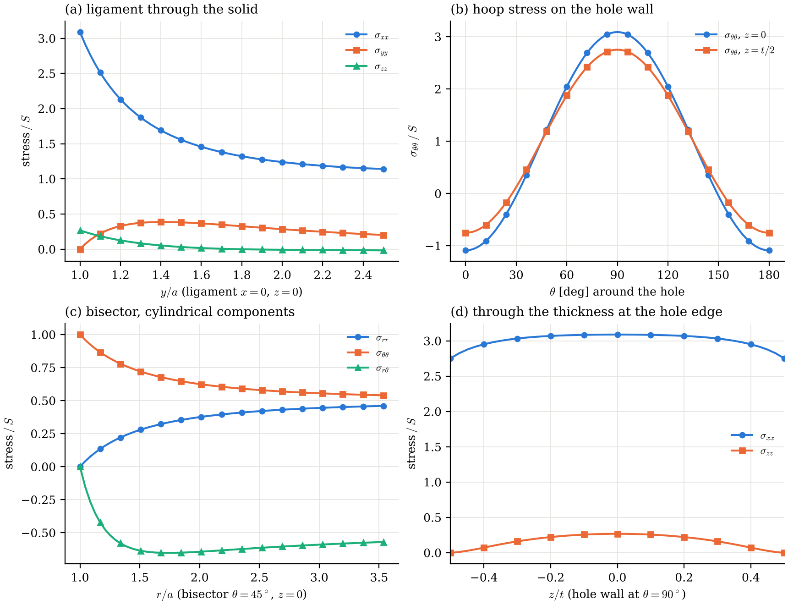
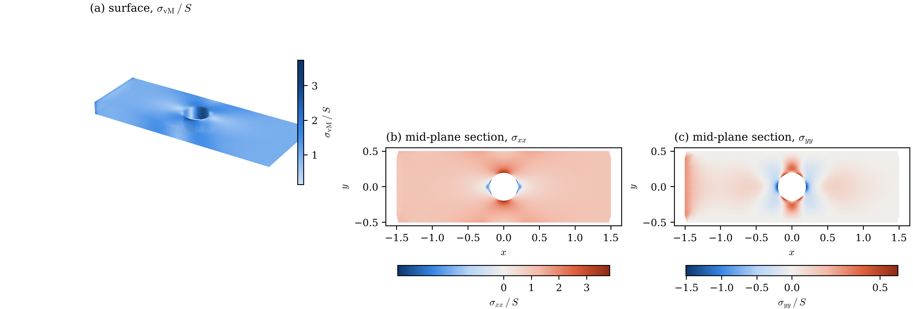
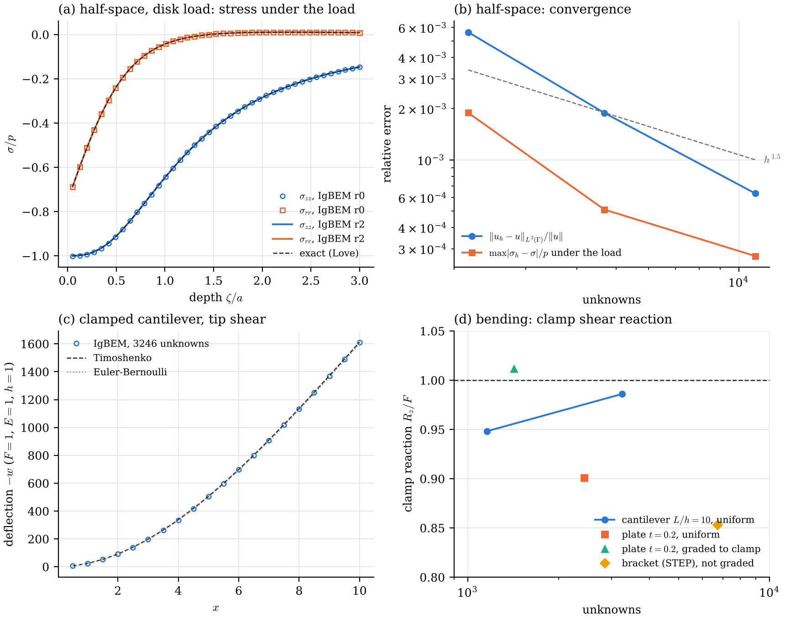
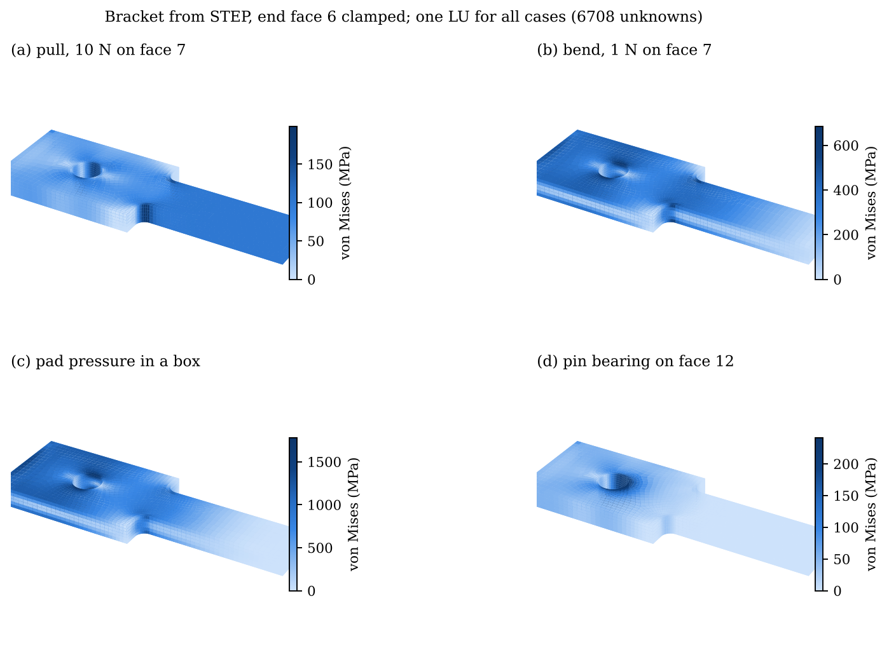
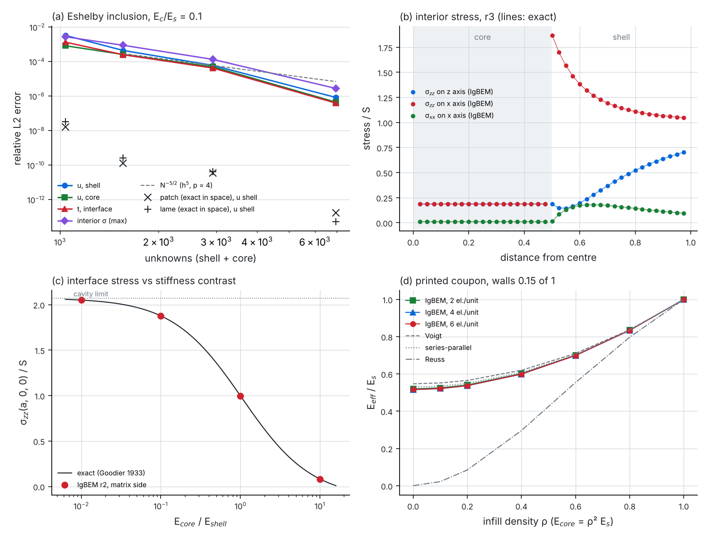

# igabem-elasticity

A 3D collocation isogeometric boundary element method (IgBEM) for linear elastostatics, following
Taus, Rodin, Hughes & Scott, *Isogeometric boundary element methods and patch tests for linear elastic
problems*, CMAME 357 (2019) 112591. This is the core that the planned extensions build on, starting
with a thickness-robust solver for thin curved plates.

**Status.**

- **Milestone 1 (SBIE, Neumann):** the interior Neumann patch test passes to machine precision on the
  watertight quadratic cube and on exact rational spheres, spheroids and a perturbed sphere. The
  imperfect cube stalls at a constant error, as it does in the paper.
- **Milestone 2 (HSBIE, Dirichlet):** the traction equation is regularized by Taylor subtraction and
  solved for a discontinuous traction space. The linear Dirichlet patch test is exact; a Kelvin
  point-load solution checks quadrature and h-convergence. See [Results](#results).
- **Milestone 3 (cube with a spherical cavity, traction-only):** a two-surface body (unit cube, exact
  rational sphere of radius 0.2 with inward-facing patches). The patch test converges to 1.6e-13; exact
  pressurized-cavity and Goodier fields converge under refinement; the stress concentration factor
  matches Goodier's 93/46 = 2.0217 to 1.1e-4. The finite cube in tension gives SCF 2.268.
- **Milestone 5 (mixed boundary conditions, interior fields, canned plots):** displacement on chosen
  patches and traction elsewhere from the same cached operators, interior stress and strain
  accurate to the boundary, line and boundary probes, and VTK output for ParaView, each with
  regression tests. See [Mixed boundary conditions](#mixed-boundary-conditions-interior-fields-probes-and-3d-output).
- **Milestone 4 (plate with a circular through-hole, traction-only), on a reusable library:** exact
  rational geometry (volume exact to 1e-13). The 3D Kirsch field converges at O(h³) for p = 2 and
  O(h⁵) for p = 4; SCF error 1.2e-5 at 5,808 unknowns in 10 s from scratch. Thickness effect and a
  finite-width strip agree with the literature. Operators are assembled once, cached on disk and
  reused for every load case.
- **Two-region bodies (wall shell + homogenized infill core):** each region has its own material
  and cached SBIE rows; the enclosed core is condensed to a Dirichlet-to-Neumann map, so the bonded
  body runs on `BcModel` with every support and load. Exact two-material fields are reproduced to
  1e-10 (Lamé two-layer sphere) and the Goodier/Eshelby inclusion converges from 3.3e-3 to 8.3e-7
  (7k unknowns, 15 s); a printed coupon's modulus against infill density converges to 0.1%. See
  [Two-region bodies](#two-region-bodies-multiregion-region_validate).

## Build and run

Requires a C++17 compiler, CMake ≥ 3.16, Eigen ≥ 3.3, optionally OpenMP; Python 3 with NumPy and
Matplotlib for geometry generation and plots.

```sh
python3 python/make_geometries.py 3      # writes geo/*.dat (cube, imperfect cube, sphere family, cube with cavity, plate with hole; r0..r3)
cmake -S . -B build && cmake --build build -j
./build/patch_test geo/cube_p2.dat cube --nmin 1 --nmax 24
./build/dirichlet_test geo/sphere_r0.dat sphere --nmin 1 --nmax 10 [--source 1.5 1.7 2.0]
./build/cavity_test geo/cube_cavity_r2.dat cav goodier --nmin 12 --nmax 12   # patch|pressure|goodier|tension
./build/plate_test geo/plate_hole_p4_t0.2_r3.dat p4r3 patch,kirsch,kirsch_free,tension 0.2   # all cases, one assembly
ctest --test-dir build                   # Kelvin kernels (finite differences) + regression of every validated case (~25 s)
./results/run_all.sh                     # Neumann runs -> results/patch_tests.csv (~10 min on 4 cores)
./results/run_dirichlet.sh               # Dirichlet runs -> results/dirichlet_tests.csv (~20 min)
./results/run_cavity.sh                  # cavity runs -> results/cavity_tests.csv, cavity_profile_*.csv (~35 min)
./build/plate_test geo/plate_hole_p4_t0.2_r3.dat p4r3 kirsch,tension 0.2 --bc clamp --fields out/p4r3   # mixed BCs, probes, .vtu
./results/run_plate.sh                   # plate runs (traction-only and clamped) -> results/plate_tests.csv, plate_profile_*.csv
./results/run_fields.sh                  # probes, .vtu, field figures -> results/fields/, results/fig_probes_*, fig_fields_*
python3 python/plot_patch_tests.py       # -> results/fig_patch_tests.{pdf,png}
python3 python/plot_dirichlet_tests.py   # -> results/fig_dirichlet_tests.{pdf,png}
python3 python/plot_cavity_tests.py      # -> results/fig_cavity_tests.{pdf,png}
python3 python/plot_plate_tests.py       # -> results/fig_plate_tests.{pdf,png}
python3 python/plot_probes.py line results/fields/p4_r3_kirsch_bisector.csv --comp s_rr,s_tt --frame cyl --x r --out fig.png
python3 python/render_vtu.py results/fields/p4_r3_kirsch --out fig.png
pip install -r python/fem_reference/requirements.txt   # IGA-FEM reference (JAXIGA, MIT)
python3 python/fem_reference/cavity_fem.py --p 4,5 --n 1,2,4   # -> results/fem_cavity.csv (+ --p 4 --n 8, ~2 min, 4 GB)
python3 -m pytest python/fem_reference -q   # FEM reference regression (~30 s)
python3 python/plot_fem_cavity.py        # -> results/fig_fem_cavity.{pdf,png}
python3 python/gen_cavity_exact.py       # (needs SymPy) re-derives src/cavity_exact_gen.hpp
python3 python/gen_kirsch_exact.py       # (needs SymPy) re-derives src/kirsch_exact_gen.hpp
pip install cadquery-ocp                 # OpenCASCADE for STEP import
python3 python/make_plate_step.py 0.2    # CAD plate with a hole -> geo/step/plate_hole_t0.2.step
python3 python/step2dat.py geo/step/plate_hole_t0.2.step geo/step/plate_hole_step_p4_t0.2_r3.dat \
        --split 1,-1,0,0,0,0 --split 1,1,0,0,0,0 --degree 4 --refine 3   # STEP -> conforming .dat (~25 s)
python3 -m pytest python/test_step2dat.py -q   # STEP pipeline regression (~2 s)
pip install gmsh                         # automatic quad layout (any STEP solid, no manual cuts)
python3 python/step_auto.py geo/step/bracket.step geo/step/bracket_auto_p3_h0.5.dat --h 0.5 --curvature 6
./build/cad_test geo/step/bracket_auto_p3_h0.5.dat bracket tension,patch --bc clamp --exclude 0.3 \
        --region fillet:-0.05,-0.6,-1,0.2,0.6,1 --region hole:-0.95,-0.4,-1,-0.55,0.4,1
python3 -m pytest python/test_step_auto.py -q  # plate, bracket, OCCT screw: watertight + volume (~45 s)
pip install numba scipy                  # cut-cell quadrature for immersed IGA-FEM unit cells
python3 -m pytest python/immersed -q     # exact cut volumes and moments, weights >= 0: box, sphere, cylinder, thin shell, slivers (~9 s; ~60 s first JIT)
cd python && python3 -m geomio ../geo/step/bracket.step bracket.stl --curvature 16   # STEP -> watertight STL, CAD face id per triangle (0.1 s)
cd python && python3 -m geomio ../geo/step/occt_screw.step bolt.vtu --order 2 --volume   # curved tri6 + TET10, mid-nodes on the CAD (0.2 s)
python3 -m pytest python/geomio -q       # STL/3MF round trips, broken-STL repair, STEP -> mesh -> cut cells, tri6/TET10 on CAD (~2 s; ~25 s first JIT)
python3 python/plot_geomio.py results/fig_geomio.png results/geomio_volume.csv   # face-coloured parts + volume convergence tri3 vs tri6
python3 python/make_boxes.py             # boxes, bars, thin plates for the local-load validation
./build/bc_validate bar geo/bar_L4_p3_n8.dat                 # exact bending / axial / spring end (0.3 s)
./build/bc_validate halfspace geo/box_hs_q_p3_r1.dat --probe results/bc_halfspace_probe_r1.csv   # disk load vs Love (18 s)
./build/bc_validate cantilever geo/bar_L10_p3_n40.dat        # clamp + tip shear vs Timoshenko (3 s)
python3 python/face_ids.py geo/step/bracket.step geo/step/bracket_exact_p3_h0.7_c3.dat   # CAD face id per patch -> .faces
./build/bc_case cases/bracket_clamped.json                   # 5 load cases by CAD face id / box, one LU (17 s, 7 s cached)
./build/bc_case cases/bracket_bolted.json                    # bolt hole fixed + elastic pad (springs) (17 s)
./build/bc_case cases/bracket_clamped_graded.json            # mesh graded at the clamp by knot insertion (40 s)
python3 python/grade_dat.py in.dat out.dat --faces 6 --inner 1,13 --h0 0.025   # the same grading by hand
python3 -m pytest python/test_grade_dat.py -q                # grading: exact surface, conforming, symmetric (~2 s)
python3 python/plot_bc_validation.py     # -> results/fig_bc_validation.{pdf,png}, fig_bc_bracket.{pdf,png}
python3 python/gen_inclusion_exact.py    # (needs SymPy) re-derives src/inclusion_exact_gen.hpp (elastic sphere in a matrix)
python3 python/make_regions.py           # two-region pairs -> geo/regions/*_{host,core}.dat (spheres r0..r3, coupons)
./build/region_validate eshelby geo/regions/sph2_a0.5_r2_host.dat geo/regions/sph2_a0.5_r2_core.dat --contrast 0.1   # (3 s)
./build/region_validate coupon geo/regions/coupon_w0.15_n4_host.dat geo/regions/coupon_w0.15_n4_core.dat   # E_eff vs infill density (15 s)
./results/run_regions.sh                 # -> results/regions/*.csv (~2 min from scratch)
python3 python/plot_regions.py           # -> results/fig_regions.{pdf,png}
```

## Library layout

Header-only C++17 in `src/`; each new case is a problem header plus a thin driver plus regression
values, not new numerics.

| Layer | Files | Content |
| --- | --- | --- |
| Geometry | `nurbs.hpp`, `mesh.hpp` | Multipatch rational B-splines, conforming dofs, Greville collocation |
| Quadrature | `quadrature.hpp`, `integrator.hpp` | Cell partition, Duffy singular rule, near-singular quadtree, adaptive far field with cached element rules |
| Kernels | `kelvin.hpp` | Kelvin U, T and traction kernels (finite-difference tested) |
| Operators | `sbie.hpp`, `hsbie.hpp`, `traction_space.hpp` | SBIE matrices H, G (H u = G t), HSBIE assembly, discontinuous traction space |
| Model | `operators.hpp`, `cache.hpp`, `neumann_model.hpp`, `mixed_model.hpp`, `model.hpp` | SBIE rows at any collocation set, cached on disk (key: geometry bytes, material, quadrature options, code version). `NeumannModel`: traction everywhere, bordered LU. `MixedModel`: displacement on chosen patches, traction elsewhere, from the same cached rows plus cached rows per Dirichlet patch. `Model`: either, chosen at run time. Any number of load cases per solve |
| Solution | `solution.hpp` | `BoundarySolution`: u and t coefficients of one case, whatever was prescribed or solved; boundary gradient, strain, stress, von Mises |
| Supports and loads | `regions.hpp`, `bc_model.hpp`, `loads.hpp`, `case_io.hpp`, `json.hpp` | Regions picked by CAD face id (`<geometry>.faces`, Gmsh surface tags as geomio), patch, box, plane, half-space, cylinder, ball or normal, cutting through patches anywhere; exact region quadrature on cut cells (marching squares + arc refinement, Duffy/adaptive near the source). `BcModel`: fixed components per support (clamp, symmetry, roller, prescribed u), springs / elastic supports t = −K u on any region, free rigid motions detected and bordered only when the supports leave them free, per-support reactions and an equilibrium residual. Loads: pressure, traction field, resultant force, resultant moment (linear traction), bearing (cosine pressure). Any number of cases on one cached LU. `case_io.hpp`: a JSON case file in the shape of nurb-fea-tcd's `bemkit.solve` supports/loads dicts (`app/bc_case`) |
| Two-region bodies | `multi_region.hpp`, `problems/two_region.hpp`, `inclusion_exact_gen.hpp` | `MultiRegion`: enclosed inclusions of their own isotropic material bonded to a host (u continuous, t₁ = −t₂). Each inclusion is collocated at its traction points (square G), giving t = S u with S = G⁻¹H, cached per patch and scaled with μ at fixed ν (density sweeps reuse one assembly). `condense` turns any host rows into H + G[:, I] S E with the interface columns removed, so `BcModel` (`regions` pointer) solves the bonded body unchanged; `complete` fills the interface tractions; interface dofs are matched by coordinates and the bases are checked to coincide. `MultiRegionEvaluator`: interior fields in whichever region holds the point. `materialEnu`, `infillMaterial` (Gibson–Ashby E = C ρⁿ E_s) |
| Post-processing | `recovery.hpp`, `interior.hpp`, `probes.hpp`, `vtk.hpp` | Boundary stress recovery; u, ∇u, ε, σ at interior points (near-boundary safe) with an inside test; line probes through the solid and curve probes on the boundary to CSV; surface and section `.vtu` for ParaView |
| Plots | `python/plot_probes.py`, `python/render_vtu.py` | Canned probe figures (any component, Cartesian or cylindrical, exact overlay) and a rendered 3D field figure |
| Problems | `problems/cube_cavity.hpp`, `problems/plate_hole.hpp`, `problems/half_space.hpp`, `*_exact_gen.hpp` | Load cases, exact fields, quantities of interest, shared by drivers and tests |
| Immersed | `python/immersed/cut3d.py`, `python/immersed/cut_quadrature.py` | Cartesian cut cells of a closed STL (exact volumes, wet faces, surface pieces; ported from kfbim-octree) and non-negative (NNLS) moment-fitted volume rules per cut cell, exact for degree ≤ 3, for immersed IGA-FEM unit cells |
| Geometry I/O | `python/geomio/` | STEP/IGES/BREP (Gmsh OCC) → watertight face-tagged triangle mesh, face id = Gmsh surface tag as in `step_auto.py`; STL read/write (binary keeps the face id in the attribute word, ASCII one solid per face) with materializr's robustness checks (binary-vs-ASCII by size, truncation, weld with fold guard, winding flood fill, outward per component by nesting); 3MF write/read (face ids as base materials); dihedral-angle face segmentation for untagged STL. Feeds `immersed/cut_quadrature.py`. `highorder.py`: curved second-order meshes (tri6 surface for BEM, TET10 for FEM) with mid-edge nodes on the CAD curves and faces, fold repair and CAD-volume checks (after nurb-fea-tcd); volume error h⁴ against h² for flat triangles |
| Tests | `tests/test_kernels.cpp`, `tests/test_regression.cpp` | Kernels; every validated result reproduced on a small mesh, including cache hit = fresh |

Not yet in the library: geometry refinement (still `python/make_geometries.py`). `patch_test` and `dirichlet_test` still
reassemble per n on purpose, because they are quadrature-convergence studies.

## Plan check

**Theory.** Displacement boundary integral equation (SBIE) for an interior domain with outward normal,
Kelvin fundamental solution in the Brebbia–Dominguez convention (`src/kelvin.hpp`). The free term is
never formed: rigid translations give σ(x) = −PV∫T dΓ, so the equation is used in the regularized form

```
∫_Γ T(x,y) [u(y) − u(x)] dΓ_y = ∫_Γ U(x,y) t(y) dΓ_y
```

Both integrands are O(1/r), so the same scheme handles smooth points, C⁰ patch edges and cube corners.
This is the paper's σ = −K·1 identity (App. C).

The traction equation (HSBIE) follows from applying the traction operator at x to the interior
representation, t_i(x) = ∫ D_im t_m − ∫ S_im u_m with D = T_x U (O(1/r²)) and S = T_x (T_y U)ᵀ (O(1/r³))
(`KelvinTraction` in `src/kelvin.hpp`; verified against finite differences by `tests/test_kernels.cpp`).
It is regularized by subtracting the linear field u_L(y) = u(x) + ∇u(x)(y − x), whose traction σ(x)n
satisfies the representation exactly. That removes the free term and leaves two O(1/r) integrands:

```
∫_Γ D(x,y) [t(y) − σ(x) n(y)] dΓ_y = ∫_Γ S(x,y) [u(y) − u(x) − ∇u(x)(y − x)] dΓ_y
```

∇u(x) combines the tangential derivatives of the Dirichlet data with the normal derivative implied by
t(x) through Hooke's law, so the unknown t(x) appears on both sides (`HsbieAssembler::gradient`). The
data part of the right-hand side is subtracted point by point, which keeps round-off at 1e-14 instead
of growing like n⁴. The subtraction needs u ∈ C¹ and t continuous at x, so traction collocation points
are kept strictly inside patches.

The cube with a cavity is a doubly bounded solid. The regularized SBIE holds unchanged, with Γ the
union of both surfaces and n outward from the solid, so into the cavity on the sphere. The rigid
translation identity behind the regularization holds over the full boundary, and the rigid modes are
still six because the solid is connected. Boundary stresses come from the solution without domain
evaluation: tangential gradient from u_h, normal derivative from the prescribed t via Hooke's law
(`src/recovery.hpp`, shared with the HSBIE).

**Mixed boundary conditions** (`MixedModel`). With u prescribed on Γ_u (whole patches) and t on Γ_t,
the unknowns are the displacement dofs not touched by Γ_u and the traction dofs on Γ_u (the traction
space is discontinuous across patches, so the traction may jump at the edge of Γ_u). The SBIE
H u = G t is collocated at the Greville points of the free displacement dofs (rows already in the
Neumann cache) and at the traction collocation points of the Γ_u patches, which are interior to those
patches. That gives as many equations as unknowns; the Dirichlet data fix the rigid modes, so there is
no bordering. The displacement data are Greville-interpolated patch by patch.

**Interior fields** (`InteriorEvaluator`). Somigliana's identity and its gradient,
u(x) = ∫U t − ∫T u and ∂u/∂x = ∫∂ₓU t − ∫∂ₓT u (`KelvinTraction::gradients`, finite-difference
tested), with the linear field u_L(y) = u(x̄) + ∇u(x̄)(y − x̄) at the closest boundary point x̄
subtracted. That is exact for any interior x because u_L satisfies both identities, and it removes the
near-singularity, so points 10⁻⁶ from the hole are as accurate as points far away. The inside test is
the solid-angle integral (1 inside, 0 outside), computed in the same loop.

**Physics.** λ = μ = 1 (ν = 1/4). Exact field u = αx, α = diag(−¼, −¼, 1), so σ = diag(0, 0, 5/2) and
t = σn. Pure Neumann data leaves the six rigid-body modes undetermined; they are removed (see Numerics).
For the Dirichlet runs a second exact field is the Kelvin solution of a unit point load at
(1.5, 1.7, 2.0), outside the unit sphere, in direction (1, 2, 3)/√14. It is smooth in the body but not
polynomial, so it tests quadrature and approximation together.
For the cavity (radius a = 0.2, centre c = (½, ½, ½)) three more exact fields are used, each with its
traction σn prescribed on both surfaces:

- the Lamé field u = p a³ (x − c) / (4μ|x − c|³), a pressure p = 1 in a cavity of an infinite medium;
- the Goodier (1933) field for remote uniaxial tension S = 1 along z around a traction-free spherical
  cavity. `python/gen_cavity_exact.py` derives it from three Papkovich–Neuber terms, checks Navier's
  equation and the free cavity symbolically, and generates the C++. Its stress concentration factor is
  σ_zz(equator)/S = (27 − 15ν)/(2(7 − 5ν)) = 93/46 ≈ 2.0217 at ν = ¼.
- the engineering case, without exact solution: the finite cube pulled by t = S e_z on z = 0, 1, with
  free lateral faces and a free cavity.

For the plate with a hole (square plate W = 1, thickness t, hole radius a = 0.2 through the thickness,
remote stress S = 1 along x) the plane-strain Kirsch field is an exact 3D solution when σ_zz = ν(σ_xx +
σ_yy) is prescribed on the faces z = ±t/2 (`python/gen_kirsch_exact.py` checks equilibrium and the free
hole symbolically). Its SCF is 3 at every z. Two cases without exact solution measure 3D effects: the
Kirsch traction on the four sides with free faces (thickness effect), and a strip of length L = 3
pulled at its ends (finite width, d/W = 0.4).

**Numerics.**

| Item | Choice | Where |
| --- | --- | --- |
| Geometry | Multipatch NURBS in Bembel `.dat` format, any degree, rational weights | `src/nurbs.hpp` |
| Displacement space | Isoparametric: the geometry's own rational basis. Control points that coincide across patches are merged into one conforming dof, so a gap (imperfect cube) leaves dofs unmerged | `Mesh::build` |
| Collocation | Greville abscissae of each dof's first owning patch | `Mesh::build` |
| Singular quadrature | Duffy split of the integration cell into up to 4 triangles at the collocation point, n×n Gauss–Legendre per triangle | `duffyRect` |
| Curvature / aspect partitioning | App. B: split cells until the normal-angle change across a cell is ≤ 1/8 rad (κh ≤ 1/8); aspect ratio ≤ 2 (App. B: 3) and opposite-edge ratio ≤ 1.5 (taper, not in App. B) | `partitionElement` |
| Far-field quadrature | Fixed n (paper) or, with `far_tol` > 0, Gauss order m per cell from the Bernstein-ellipse bound ρ^(−2m) < far_tol, ρ from distance / bounding radius; element-wide rules with geometry, basis and data evaluated once | `ElementIntegrator` |
| Near-singular quadrature | App. B: quadtree refinement towards the closest point while d ≤ 3h | `nearRect` |
| Solver | Dense bordered system [A R; Rᵀ 0] with the 6 rigid modes R, partial-pivot LU | `app/patch_test.cpp` |
| Error measure | Relative L²(Γ) displacement error after removing the L²-best rigid motion, 10×10 Gauss per cell | `relativeL2Error` |
| Rank / conditioning | Full SVD of A every run: σ₆/σ_max (should vanish with the quadrature error, rank deficiency 6) and σ₇/σ_max (smallest non-rigid singular value) | `patch_test` output |
| Kernel check | ‖A·R_rot‖/‖A‖: rotations carry zero traction, so this must vanish. It catches sign or index errors in T | `patch_test` output |
| Traction space (HSBIE) | The geometry's rational basis on each patch, discontinuous across patches (no merging), as the paper prescribes at edges and corners | `TractionSpace` |
| Traction collocation | Greville points with the first and last moved halfway inwards, so every point is interior to its patch | `TractionSpace::shifted` |
| Dirichlet data | Exact coefficients for u = αx; Greville interpolation for the point-load field | `interpolateDisplacement` |
| Solver (HSBIE) | Dense partial-pivot LU; 2-norm condition number from a full SVD every run | `app/dirichlet_test.cpp` |
| Shared quadrature | One driver for both equations: Duffy at the source point, App. B near-singular quadtree, Gauss elsewhere | `src/integrator.hpp` |
| Cavity geometry | Quadratic cube (6 patches) plus Bembel's sphere scaled to a = 0.2 with u and v swapped so its normals point into the cavity; both refined together (12 → 768 elements). Orientation check: the computed volume is 1 − 4πa³/3 to 1e-13 | `make_geometries.py` |
| Cavity solver | Same bordered SBIE system; general traction data t(y, n); SVD rank check every run | `app/cavity_test.cpp` |
| Stress recovery | σ on Γ from tangential gradient of u_h plus t, at the equator point c + a e_x and along the meridian in the x–z plane | `src/recovery.hpp` |
| Plate geometry | 16 biquadratic rational patches (each face quadrant blends the hole arc to the square edge; straight radial lines), exact degree elevation to p = 4, then k-refinement (16 → 1,024 elements); optional end blocks for a longer strip. Geometry error is zero: volume (L − πa²)t to 1e-13 | `make_geometries.py` |
| Singular cell (adaptive mode) | Duffy on a block around the source point of half-width equal to its distance to the nearest cell edge (aspect ≤ 2), adaptive quadtree on the rest of the cell. Plain Duffy over the whole cell converged algebraically for points close to, but not on, a cell edge (traction collocation points: 6.5e-5 at n = 12 → 2.5e-10) | `ElementIntegrator::singularRect` |
| Interior quadrature | Same adaptive quadtree with the field point off the surface (split while the cell's bounding sphere is within 1.5 radii or the Bernstein-ellipse order exceeds n) | `InteriorEvaluator` |
| Plate data | Traction data interpolated in the traction space (t ≈ Σ N_j t_j), so the right-hand side is G t for any load; integrating the data exactly is kept as a check (`--exact-data`) | `NeumannModel::solve` |

**Visualization.** Semilog plots of error against integration points per direction, matching the
paper's Figs. 2, 3, 6 and 7, plus a CSV of every run (`results/*_tests.csv`). The plate figure adds
log-log error against unknowns and against wall time with h^(p+1) reference slopes, SCF error, and
the through-thickness stress profile. Field figures (`results/fig_probes_*`, `results/fig_fields_*`):
BEM as solid lines with markers, the exact field as thin dashed lines; one-hue sequential colour scale
for magnitudes (von Mises, error), blue–red diverging scale centred on zero for signed components.

## Assumptions and deviations (please read)

1. **The base quadrature of Taus, Rodin & Hughes (MMMAS 2016) was not available and is reconstructed.**
   This code uses Duffy/polar splitting at the collocation point on the regularized integrands. That is a
   standard scheme with the same property the paper relies on (exponential convergence in n), but it is
   not guaranteed to be their rule.
2. **The HSBIE regularization is also a reconstruction.** It is the classical constant-strain (Taylor)
   subtraction, not necessarily the "same technique as Laplace" the 2019 paper cites. One consequence:
   for u = αx the regularized residual of the exact solution vanishes point by point, so the linear
   Dirichlet patch test is passed for every n and does not test the quadrature. The paper's Fig. 5 shows
   exponential convergence in n, so its regularization must differ. The point-load test fills that gap.
3. **Cross-check with Keshava & Schanz (2025, [arXiv 2505.00713](https://arxiv.org/abs/2505.00713)).**
   Followed: the Kelvin tensor (their eq. 5, identical to ours after substituting ν), the form of the
   HBIE (their eq. 7: K′ = T_x U and D = −T_x(T_y U)ᵀ, our D and S up to that sign convention), and Duffy
   + Gauss for weakly singular collocation integrals. Not followed: their regularization of the
   hypersingular operator (eq. 23, after Han and Nédélec). It moves surface-curl derivatives onto the
   Galerkin test function v(x), which does not exist at a collocation point; their own collocation
   examples use only the SBIE. Their line integrals vanish on our closed surfaces, and they matter again
   only for open surfaces or a split into Dirichlet and Neumann parts.
4. The κh ≤ 1/8 criterion is estimated from the normal-angle span of a cell (centre-to-corner angle × 2),
   not from principal curvatures.
5. Traction data are evaluated exactly at quadrature points (t = σn with the discrete geometry's normal)
   instead of being projected onto a traction basis, except in the plate runs, which interpolate it so
   the operators can be reused for every load (item 8).
6. Rigid-body removal: the paper says only that rigid motion is "nullified"; here it is a bordered system
   plus an L²-best rigid fit in the error.
7. The sphere is Bembel's exact six-patch rational quartic (`geo/bembel_sphere.dat`, from
   [temf/bembel](https://github.com/temf/bembel), GPL-3.0). The spheroid is its exact affine image. The
   perturbed sphere is a smooth radial perturbation of the control points, not the paper's
   parametrization. Bembel itself is not linked yet; its H² compression is the planned route to the fast
   solver.
8. **Plate runs use three numerics changes not in the paper.** (a) Partition aspect ratio 2 instead of
   3 and a taper split: without them the plate's tapered cells converged slowly in n. The cube, sphere
   and cavity results are unchanged (regression test). (b) Adaptive far-field Gauss order
   (`far_tol` = 1e-10) instead of a fixed n: it reproduces the fixed n = 12 results to 8 digits at
   1/25 of the cost. (c) Interpolated traction data: at p = 2, r3 the Kirsch error is 4.6e-4 with
   interpolated data and 8.3e-4 with exact data, so interpolation costs nothing in accuracy here.

## Results

### Interior Neumann (SBIE)

| Geometry | Dofs (unknowns) | Integration cells | n for error < 1e-12 | Best error (n) | Error at n = 10, no partitioning |
| --- | --- | --- | --- | --- | --- |
| Cube, 6 quadratic patches (watertight) | 26 (78) | 6 | 15 | 1.4e-14 (23) | 3.2e-9 (flat faces: same as partitioned) |
| Cube, one control point moved by 1e-3 | 27 (81) | 6 | never: stalls at 1.5e-3 | 1.5e-3 | 1.5e-3 |
| Exact sphere, 6 rational quartic elements | 98 (294) | 6,144 | 9 | 4.1e-14 (10) | 1.3e-5 |
| Exact spheroid κ = 2 | 98 (294) | 3,816 | 13 | 8.1e-14 (15) | 4.5e-4 |
| Perturbed sphere | 98 (294) | 5,052 | 9 | 3.7e-14 (12) | not run |
| Exact sphere, refined once (24 elements) | 152 (456) | 6,144 | 9 | 3.6e-14 (10) | not run |

Diagnostics on every watertight case: the rotation residual ‖A·R_rot‖/‖A‖ reaches 1e-14, the six rigid-mode
singular values fall to the quadrature error, and σ₇/σ_max stays fixed (0.082 cube, 0.0048 sphere), so
A has numerical rank 3M − 6 and the bordered system is well conditioned. On the imperfect cube the rotation
residual stays at 4.7e-5: the gap breaks the rigid-body identity, which is exactly what this patch test is
meant to expose. The paper reports a stall near 1e-4 for its imperfect cube (Fig. 3); our 1.5e-3 uses a
different normalization (relative L²(Γ) after rigid-motion removal) and is not directly comparable.

Without partitioning the error still decays exponentially but much more slowly (sphere 9e-12 and spheroid
6e-7 at n = 24), reproducing the qualitative message of the paper's Figs. 6–7.


### Interior Dirichlet (HSBIE)

| Case | Traction unknowns | Result | Reference |
| --- | --- | --- | --- |
| Linear patch test, quadratic cube | 162 | 2.5e-15 – 9e-14 for every n | exact |
| Linear patch test, exact sphere | 450 | 4e-14 (n = 1) to 1.5e-12 (n = 10) | exact |
| Linear patch test, spheroid κ = 2 | 450 | stalls at 3.2e-2 for every n | t = σn is not in the traction space (n is not rational on a spheroid) |
| Point load, sphere, 6 elements | 450 | 2.7e-2 | interpolation 1.3e-2 |
| Point load, sphere, 24 elements | 648 | 7.6e-3 | interpolation 3.7e-3 |
| Point load, sphere, 96 elements | 1,152 | 8.1e-4 | interpolation 8.5e-4 |
| Point load, sphere, 384 elements | 2,592 | 2.0e-5 (n ≥ 5) | interpolation 1.7e-5 |

All results are relative L²(Γ) traction errors.

- **Linear patch test.** Exact to round-off on the cube and the sphere, but for every n, including n = 1.
  With Taylor subtraction the residual of the exact solution vanishes point by point (see assumption 2),
  so this test checks consistency of the formulation, not the quadrature. On the curved sphere round-off
  grows slowly with n (1.5e-12 at n = 10), from cancellation inside the t(x)-dependent matrix terms. The
  spheroid stalls, as in the paper's Fig. 5, because its normal is not exactly representable.
- **Point-load solution.** The quadrature converges by n ≈ 4–6 at every refinement level. The error then
  stays within a factor of about 2 of the traction interpolation error at every level, so the method is
  quasi-optimal. Between 96 and 384 elements the error drops by a factor of 40, a rate of 5.3, matching
  p + 1 = 5 for the quartic sphere. The coarser levels are still pre-asymptotic: the source sits 1.9 radii
  from the centre.
- **Conditioning.** 2-norm condition numbers are 146 (cube) and 1,241 → 139 (sphere, 6 → 384 elements).
  They decrease under refinement, consistent with the paper's claim that the regularized system stays well
  conditioned.


### Cube with a spherical cavity (SBIE, traction-only)

| Case | Elements (dofs) | Displacement error | σ_zz at equator | Reference |
| --- | --- | --- | --- | --- |
| Patch test u = αx | 12 (124) | 1.6e-13 at n = 16 | 2.5000000 | 5/2 |
| Pressurized cavity | 12 → 768 (124 → 1,216) | 7.1e-2 → 6.0e-4 | 0.50257 → 0.50004 | p/2 = 0.5 |
| Goodier field | 12 → 768 | 1.4e-2 → 1.6e-4 | 2.0331 → 2.02152 | 93/46 = 2.02174 |
| Finite cube in tension | 12 → 768 | — | 2.286 → 2.268 | none (Goodier 2.022 for an infinite body) |

Displacement errors are relative L²(Γ) after rigid-motion removal; n = 12 unless noted.

- **Patch test.** Exponential convergence in n, but slower than on the lone sphere (1e-12 at n = 14
  rather than n = 8). The slowest integrals are the near-singular cube-face integrals seen from the
  cavity, 0.3 away from faces of size 1. The quadrature is not the bottleneck for the load cases: σ_zz at
  the equator changes by less than 1e-5 relative for n ≥ 7 and converges exponentially (panel a).
- **h-refinement.** From 192 to 768 elements the Goodier displacement error drops by 13 and the SCF error
  by 15 (rates 3.7 and 3.9), and the pressure case by 12 (rate 3.6). The coarser steps are pre-asymptotic.
  The quadratic cube faces cap the asymptotic displacement rate at p + 1 = 3 there, below the quartic
  sphere; degree-elevating the cube would lift it. The SCF matches Goodier to 1.1e-4 relative at 768
  elements.
- **Finite cube in tension.** SCF 2.268 at 768 elements, changing by 1e-2 from 192 elements, so about
  2.27 to within ~1e-3 by analogy with the Goodier sequence. It is 12% above the infinite-medium value,
  the finite-width effect of a cavity spanning 40% of the cube. The compressive pole stress also grows,
  from −0.587 S to about −0.74 S. The independent IGA-FEM check below gives 2.2689.
- **Rank.** σ₆/σ_max falls to 4e-13 with n (six rigid modes, exact null space); σ₇/σ_max rises from
  1.4e-3 to 7.1e-3 under refinement, so the reduced system stays well conditioned.



### Independent IGA-FEM check of the cavity cases (JAXIGA, Galerkin)

`python/fem_reference/` solves the same cube-with-cavity problems as a 3D volume Galerkin IGA-FEM. It uses
[JAXIGA](https://github.com/CMU-CBML/JAXIGA) (MIT) for the NURBS spaces, multipatch gluing and basis
evaluation, plus a short NumPy/SciPy assembler and SuperLU.

- **Model.** The octant [0, ½]³ \ B(0, a), with u_n = 0 on the three symmetry planes. This is exact for all
  three load cases and also removes the rigid motions.
- **Geometry.** Three exact NURBS volumes (`octant_geometry.py`). Each is a quarter of Bembel's
  rational-quartic sphere patch (the same surface the BEM uses), ruled to its central projection onto the
  cube face. The cavity radius and the face planarity hold to 1e-16, the patches conform (JAXIGA's
  interface check), and det J > 0. Degree is p in all three directions, n elements per direction per
  patch, with radial knots w = s^1.5 graded toward the cavity.
- **Quadrature.** p + 3 Gauss points per direction. With JAXIGA's default p + 1, the patch test fails at
  1e-5, because the rational stiffness is under-integrated.
- **Cost.** K is assembled and factored once per mesh and reused for all three load cases. At p = 4, n = 8
  (14,292 dofs): 57 s assembly, 23 s SuperLU, under 1 s per load case. `jx.solve` gives the same answer
  to 1e-12 but spends ~55 s at 4k dofs in JAX compilation. p = 5, n = 8 (~20k dofs) runs out of memory
  in SuperLU on a 15 GB machine.

| Case | p | n = 1 | n = 2 | n = 4 | n = 8 | Reference |
| --- | --- | --- | --- | --- | --- | --- |
| Patch test, rel. L² error of u | 4 | 9.8e-9 | 1.0e-10 | 1.5e-13 | 2.2e-15 | 0 |
| Goodier SCF | 4 | 2.06983 | 2.03742 | 2.02085 | 2.021678 | 2.021739 |
| Goodier SCF | 5 | 2.04793 | 2.02738 | 2.02108 | — | 2.021739 |
| **Finite cube SCF** | 4 | 2.31759 | 2.28823 | 2.26802 | **2.26893** | IgBEM r3: 2.26827 |
| Finite cube SCF | 5 | 2.29997 | 2.27535 | 2.26822 | — | |
| dofs (octant) | 4 / 5 | 915 / 1,638 | 1,638 / 2,667 | 4,056 / 5,859 | 14,292 | |

- **Verdict.** The two methods agree on the finite-cube SCF to 6.6e-4 (0.03%). The finest FEM
  Goodier SCF is off by 3e-5 relative and the finest BEM Goodier SCF by 1.1e-4, so the SCF is
  **2.269 ± 0.001**. Along the whole cavity meridian the two σ_θθ profiles differ by less than 8e-4 S
  (panel c, inset).
- **Convergence.** At p = 4 the Goodier SCF error drops 14× from n = 4 to n = 8, a rate of 3.8 in h.
  The finite-cube sequence undershoots at n = 4 like the Goodier one does, so the asymptotic regime
  starts at n ≈ 4.
- **Efficiency.** Per unknown, the BEM is more accurate even though it models the full surface and the
  FEM models only an octant volume: 1.1e-4 SCF error at 3,648 unknowns, against 4.3e-4 at 4,056 (panel a).



### Plate with a circular through-hole (SBIE, traction-only)

All runs: `NeumannModel` with adaptive far field (`far_tol` = 1e-10, n = 12 near field), interpolated
traction data, 4 cores. Time = assembly of H and G + LU + solve of all four load cases; a rerun with the
operators in `cache/` skips assembly.

| Mesh | Unknowns | Kirsch u error | SCF mid-plane (exact 3) | Assembly | LU | 4 solves |
| --- | --- | --- | --- | --- | --- | --- |
| p = 2, 64 el. | 432 | 5.6e-2 | 3.1682 | 0.12 s | 0.005 s | 0.002 s |
| p = 2, 256 el. | 1,200 | 1.0e-2 | 3.0071 | 0.32 s | 0.05 s | 0.01 s |
| p = 2, 1,024 el. | 3,888 | 4.6e-4 | 2.99941 | 1.95 s | 0.72 s | 0.07 s |
| p = 4, 64 el. | 1,200 | 6.6e-3 | 2.99676 | 0.66 s | 0.04 s | 0.01 s |
| p = 4, 256 el. | 2,352 | 5.0e-3 | 3.0123 | 1.30 s | 0.19 s | 0.03 s |
| p = 4, 1,024 el. | 5,808 | 3.8e-5 | 2.999963 | 7.57 s | 2.06 s | 0.17 s |

- **Order.** The last step gives rate 4.5 for p = 2 and 7.0 for p = 4 in h (expected p + 1 = 3 and 5; both still above the asymptote);
  the middle p = 4 step is pre-asymptotic (the interpolation error of the space shows the same plateau,
  and the BEM error stays within 2.4× of it). An SCF accurate to 1e-3 needs about 3,000 unknowns at
  p = 2 and about 1,200 at p = 4; 1e-5 needs p = 4 and about 6,000 (panel c).
- **Geometry error is zero:** the rational patches reproduce the hole and the faces exactly.
- **Patch test** u = αx on every mesh: 1e-9 to 3e-6, the floor set by `far_tol`, 10× below the finest
  Kirsch error.
- **Thickness effect** (Kirsch traction on the sides, free faces, p = 4, 1,024 el.):

  | t/a | SCF mid-plane | SCF at the face |
  | --- | --- | --- |
  | 0.5 | 3.026 | 2.957 |
  | 1 | 3.062 | 2.879 |
  | 2 | 3.089 | 2.752 |

  Uncertainty ≈ 0.01 (change from the 256-element mesh). The mid-plane rises above 3 and the face drops
  below it as the plate thickens, as in Folias & Wang, *Comput. Mech.* 6 (1990) 379–391, who give
  curves but no tables, so the comparison is qualitative.
- **Finite-width strip** (L = 3, d/W = 0.4, t/a = 1, p = 4): SCF on the gross stress 3.794, 3.810, 3.832
  at 1,800, 3,528, 8,712 unknowns (face 3.557, 3.560, 3.578); the r3 run takes 30 s. Plane stress
  (Howland 1930 via the Peterson curve fit Kt,net = 2 + 0.284(1−d/W) − 0.600(1−d/W)² + 1.32(1−d/W)³,
  quoted from memory and not checked against the book) gives Kt,net = 2.240, gross 3.733; times the
  mid-plane thickness factor 3.062/3 from the table above, 3.81. The BEM agrees to 0.6%, the size of its
  own last mesh change. Heywood's simpler 2 + (1−d/W)³ gives 3.69.
- **Square plate in tension** (L = W = 1): SCF 4.89 mid-plane. The loaded ends are only 1.5 a from the
  hole edge, so this is a geometry study, not a Kirsch comparison, and it has no reference.



### Mixed boundary conditions, interior fields, probes and 3D output

**Mixed problem** (end face x = −L/2 clamped, traction elsewhere, `--bc clamp`; same cached rows):

| Case | Mesh | Unknowns | Result | Reference |
| --- | --- | --- | --- | --- |
| Patch test u = αx | every mesh | 192 → 5,808 | u error 8e-9 → 3e-7 | 0 (quadrature floor of `far_tol`) |
| Kirsch, end clamped to the exact u | p = 4, 1,024 el. | 5,808 | u error 3.7e-5, SCF 2.999971 | free: 3.8e-5, 2.999963 |
| Kirsch, end clamped | p = 2, 1,024 el. | 3,888 | u error 4.4e-4 | free: 4.6e-4 |
| Strip L = 3 in tension, clamped at x = −3/2 | p = 4, r1 → r3 | 1,800 → 8,712 | SCF 3.797, 3.812, 3.834 | free strip 3.794, 3.810, 3.832 |
| Square plate in tension, clamped | p = 4, r3 | 5,808 | SCF 4.147 | free 4.89 (end only 1.5a from the hole) |

The clamped Kirsch runs converge exactly like the traction-only ones (panel a of the plate figure,
open markers), and in the long strip the clamp changes the SCF by 0.03%, as Saint-Venant's principle
says it should 6.5a from the hole. On the square plate the clamp sits 1.5a from the hole edge and
lowers the SCF by 15%, a real effect of the restrained Poisson contraction, not an error.

**Interior fields** (p = 4, 1,024 elements, Kirsch): the stress error along the ligament is
1.5e-5 relative from y = a + 10⁻⁶ to y = 1.5a and 2e-4 at y = 0.49, next to the loaded outer face;
over the whole mid-plane section it stays below 1e-4 of max |σ| (`fig_fields_kirsch`, panel c). The
interior patch test reproduces σ to 6e-10. One point costs about 13 ms on one core
(1,024 elements); the section (2,425 points), five probes and the surface file together take 11 s on 4
cores.

**Canned output** (`plate_test --fields`, `results/run_fields.sh`, about 75 s for the three cases
below):

- `*_ligament.csv`, `*_bisector.csv`: lines through the solid at z = 0 (60 segments).
- `*_hole_mid.csv`, `*_hole_face.csv`, `*_hole_z.csv`: on the hole wall around θ at z = 0 and on the
  face, and up the wall at θ = 90°.
- `*_surface.vtu`, `*_section.vtu`: whole surface and the mid-plane section, with displacement,
  traction, the stress and strain tensors, von Mises, and the exact stress and error where known.
  Open them in ParaView.

Every CSV has all 6 stress and 6 strain components, the displacement and von Mises, plus the exact
values where there is an exact field. `plot_probes.py line` plots any of them in Cartesian or
cylindrical components.




Thick plate (t/a = 2, Kirsch load on the sides, free faces). The hoop stress at the face drops to 2.75
while the mid-plane rises to 3.09, and σ_zz peaks at 0.27 S inside the wall and vanishes on the
faces:



Long strip clamped at one end and pulled at the other:



### Local supports and loads (`BcModel`, `bc_validate`, `bc_case`)

Supports and loads go on any part of the surface: a CAD face, or a selector that cuts through
patches (the load region is integrated exactly on cut cells, so the mesh need not follow it).

| Case | Unknowns | Result | Reference |
| --- | --- | --- | --- |
| Bar, symmetry plane + resultant moment / axial force / spring end | 582 | u error 1e-8, σ error 1e-8 | exact polynomial fields |
| Half-space, pressure disk the mesh does not follow (quarter model, exact far-field traction) | 2,166 → 10,980 | u error 5.6e-3 → 6.3e-4 (h^1.5); max σ error under the load 1.9e-3 → 2.7e-4 p | Love (Boussinesq integrated) |
| Cantilever L/h = 10, clamped, tip shear | 1,158 → 3,246 | tip w +0.58% → −0.15%, mid-span σ_xx +0.54% → +0.13% | Timoshenko |
| Thin plate t = 0.2 clamped, tip shear: equilibrium residual | 2,430 uniform; 2,682 graded by knot insertion | 9.9%; 0.47% | 0 |
| Bracket from STEP, end face clamped, 5 cases on one LU, uniform mesh | 6,708 | 17.5 s; residual 0.15 (bend), 0.12 (press), 2e-3 (pull, pin) | statics |
| The same, graded at the clamp (`"grade"`) | 11,292 | 40 s end to end incl. grading; residual 4.6e-3 (bend), 9.5e-3 (press), 1.4e-2 (twist), 1.1e-3 (pull, pin) | statics |

The clamp reaction in bending is the delicate quantity: the transverse shear is carried in the
singular corner zone of the clamp, over about one wall thickness. `python/grade_dat.py` (or
`"grade"` in a case file) refines the mesh there by knot insertion, so the geometry stays exact and
the mesh conforming: the faces next to the support get elements h0, h0·1.4, … away from it, and
with `inner` the clamp face itself is graded through the wall thickness (towards the faces that
carry the bending stress). Knots propagate through every patch that shares the refined
parameter lines. On the bracket this takes bending equilibrium from 15% to 0.5%. Torsion stays at
1.4% (grading the clamp's lateral edges as well did not help and cost 14k unknowns). `bc_case`
prints the equilibrium residual of every case, and `--max-residual` turns it into a test.




### Two-region bodies (`MultiRegion`, `region_validate`)

A 3D-printed part is a solid wall shell around a sparse infill core. The core is modelled as a
homogenized isotropic solid bonded to the wall (displacement continuity, traction equilibrium).

**Theory.** Each region has its own SBIE with its own Kelvin kernel. The core's boundary is all
interface, so its SBIE is collocated at the traction collocation points of all its patches; then
G_core is square and the core is a collocation Dirichlet-to-Neumann map t_core = S u_core with
S = G_core⁻¹ H_core (rigid motions are in its null space: ‖S R‖/‖S‖‖R‖ ≤ 1e-12). With
t_shell = −t_core on the interface, the shell rows become (H + G[:, I] S E) u = G[:, outer] t:
a single-region problem on the shell mesh, which `BcModel` solves with supports, springs,
loads, reactions and free rigid modes unchanged. At fixed ν the core's U scales with 1/μ and T does
not depend on μ, so S(μ) = μ S(1) and an infill-density sweep reuses one assembly.

**Geometry.** One `.dat` per region (`python/make_regions.py`). The shell holds the outer surface
plus the interface patches transposed in u and v (normals into the core); the core holds the same
patches oriented outward. The interface must be conforming. Dofs are matched by coordinates and the
two sides' bases are checked to coincide, so a non-conforming pair fails at setup.

**Validation.** The spheres have radii 1 (shell) and 0.5 (core), quartic exact rational
geometry, and E_core/E_shell = 0.1 with ν = 0.35 / 0.3 unless noted. All errors are relative
L²(Γ).

| Case | Unknowns (shell + core) | u error shell / core | interface t error | σ_zz(a,0,0) matrix side | Time |
| --- | --- | --- | --- | --- | --- |
| Same-material patch test u = αx | 1,038 → 6,960 | 1.6e-8 → 1.7e-13 | 4.2e-9 → 2.8e-10 | exact to 1e-9 | 3–15 s |
| Two-layer Lamé sphere, external pressure | 1,038 → 6,960 | 3.2e-8 → 5.3e-14 | 9.6e-9 → 2.2e-11 | exact to 1e-9 | 2–6 s |
| Eshelby inclusion, r0 | 1,038 | 3.3e-3 / 8.3e-4 | 1.3e-3 | 1.873124 | 3.9 s |
| Eshelby inclusion, r1 | 1,560 | 4.4e-4 / 2.6e-4 | 2.5e-4 | 1.875791 | 3.0 s |
| Eshelby inclusion, r2 | 2,928 | 6.0e-5 / 5.0e-5 | 4.2e-5 | 1.876477 | 2.8 s |
| Eshelby inclusion, r3 | 6,960 | 8.3e-7 / 4.4e-7 | 3.9e-7 | 1.876442 | 15 s (6 s cached) |
| Exact (Goodier 1933) | | | | 1.876441 | |

- **Exact in the space.** The patch and Lamé fields are linear on each spherical surface, so they lie
  in the discrete space. Their errors are the quadrature error (far_tol = 1e-10), which is the test
  of the interface matching, the signs and the condensation with two different materials.
- **Order.** The Eshelby displacement error drops by 7.5, 7.3 and 72 per halving of h (rates 2.9,
  2.9, 6.2), and the matrix-side interface stress error goes 1.8e-3 → 5e-7. The quartic sphere's
  asymptotic rate is p + 1 = 5; the coarse steps are pre-asymptotic, as on the plate with a hole.
- **Contrast.** At r2 the interface stress matches the exact value to 3e-5 relative for
  E_core/E_shell = 0.01, 0.1, 1 and 10 (panel c), from near-cavity (2.050) to a stiff inclusion
  (0.082 S in the matrix, 1.753 S in the inclusion). Interior stress along both axes, through both
  regions, is within 2.8e-6 of the exact field at r3, and the inclusion stress is uniform (Eshelby).
- **Cost.** At r3 the shell rows take 4.7 s, the core rows 2.3 s, the core LU and S 1.3 s, the
  condensation 0.5 s and the shell LU 1.1 s. The core adds 3 Nt/3M ≈ 0.6× the shell unknowns, and
  they never enter the LU.

**Printed coupon.** The coupon is [0, 4] × [0, 1]², with walls of thickness 0.15 on all six faces
and E_core = ρ² E_s (Gibson–Ashby, ν_core = 0.3). The ends are pulled by a prescribed u_x on rollers:

| ρ | 0 (hollow) | 0.1 | 0.2 | 0.4 | 0.6 | 0.8 | 1 (solid) |
| --- | --- | --- | --- | --- | --- | --- | --- |
| E_eff/E_s, 6 el./unit (5,772 unknowns) | 0.5159 | 0.5212 | 0.5369 | 0.5988 | 0.6987 | 0.8338 | 1.0000 |
| Voigt / series-parallel | 0.547 / 0.529 | 0.551 / 0.534 | 0.565 / 0.549 | 0.619 / 0.607 | 0.710 / 0.703 | 0.837 / 0.835 | 1 / 1 |

The modulus changes by less than 1e-3 between 4 and 6 elements per unit. The solid limit is exact
(1 + 1e-7, a uniform field), and every value lies between Reuss and Voigt, close to the
series-parallel estimate. A density sweep costs one condensation and one LU per density (3.8 s
at 5.8k unknowns), with nothing reassembled.

**Limits.** The core must be enclosed: every patch of it lies on the interface, which is what a printed
part's perimeters plus top and bottom layers give. A region that also reaches the outer surface (a
bimaterial bar, an insert) needs the general multi-domain system with its own supports and loads;
that is the next brick. The materials are isotropic, and the infill law's C and n are parameters to
be fitted, not data.



## Next steps

1. Exterior Neumann (Eshelby) patch test; move geometry
   refinement into C++; partial-patch Dirichlet regions (today a fixed support is a union of whole
   patches; partial regions take loads and springs).
2. Thin curved plate (cylindrical panel built as exact NURBS): Neumann patch test for t/R = 10⁻¹…10⁻³,
   then Scordelis–Lo as a 3D solid.
3. Iterative solver, preconditioner and H² compression.
4. General multi-domain coupling (regions that reach the outer surface, inserts, bimaterial bars);
   the bracket with two walls and a gyroid core from an inward offset of its outer patches; the TCD
   failure layer on the wall stresses.

## License

GPL-3.0 (see `LICENSE`), matching Bembel, whose sphere geometry is included and whose library is the
intended base.
